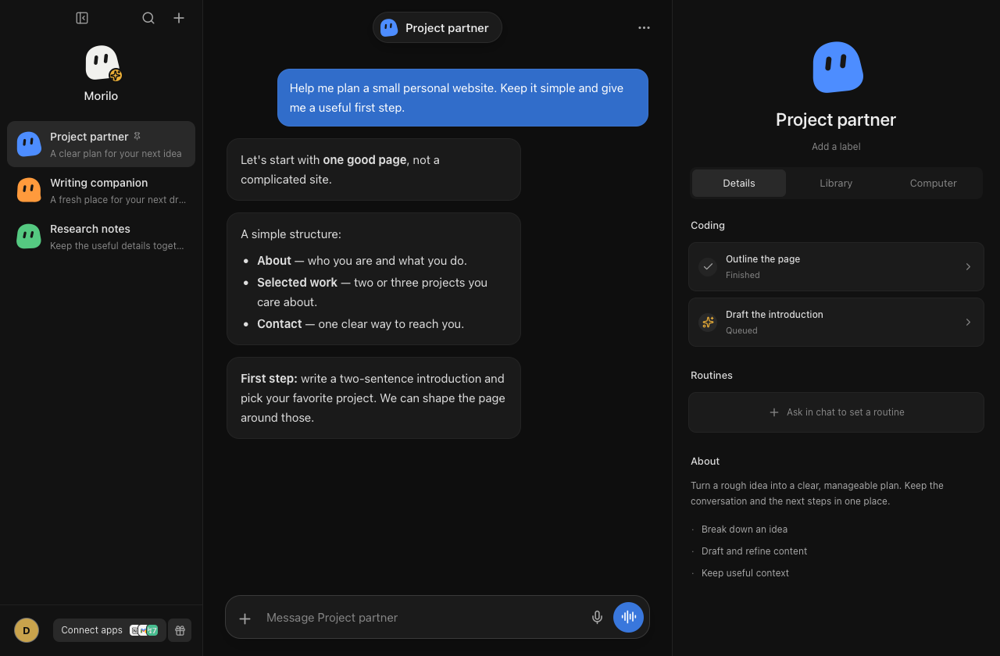

# Morilo

**Your AI workspace, on your desktop.**

English | [简体中文](README.zh-CN.md)

Morilo is an early-stage desktop AI app built with Go, MyGo and React. Keep separate assistants and conversations in one place, with streaming replies, local profiles and optional connections to apps and a remote computer. Agent sessions are powered by the Pi RPC CLI.



*Native macOS interface with illustrative sample conversations, not a recorded live model run.*

## What it does

- **Multiple assistants and conversations** — organize different kinds of work without putting everything in one thread.
- **Streaming, readable replies** — Markdown, short message bubbles and a compact progress indicator instead of raw tool logs.
- **Local profiles and history** — keep conversations, preferences and imported memory on your device, separated by profile.
- **Personal preferences** — light/dark themes, accent colors, English/Chinese UI and timezone-aware context.
- **Optional connected apps** — GitHub and Vercel integrations through Composio, limited to the implemented read-only tool allowlist.
- **Optional remote computer** — connect an Instabox machine, watch its desktop and opt into interactive control.

> **Project status:** macOS is the currently validated desktop target. Some screens, including billing, referrals, routines and parts of the vault, are demo or local-only UI rather than complete production services. Browser preview uses simulated replies; real agent execution requires the desktop app and a configured model provider.

## Run locally

### Requirements

- macOS for the validated native workflow.
- Go **1.27.3 or later**.
- Node.js **24** and npm (the tested development setup).
- A Pi CLI supporting `pi --mode rpc`, available as `pi` on `PATH` (**1.5.0** is the tested version).
- Access to a model provider for real chat.

```bash
git clone https://github.com/hifizz/morilo.git
cd morilo
npm ci
npm --prefix frontend ci
npm run dev
```

On macOS, `npm run dev` prepares a dedicated local development signing identity, starts Vite on port 3000, and opens **Morilo Dev.app**. An Apple Developer subscription is not required for this local workflow. See [development and signing notes](docs/development.md) for details.

### Configure a model provider

Opening the UI does not automatically configure model access. Morilo initializes its own Pi configuration under the app's user-data directory; it does **not** use your global Pi configuration.

| Build | Pi configuration directory |
| --- | --- |
| Development | `~/Library/Application Support/Morilo Dev/pi-agent/` |
| Packaged app | `~/Library/Application Support/Morilo/pi-agent/` |

The relevant files are `models.json`, `settings.json` and `auth.json`. Missing files are initialized when a chat session starts; see the defaults in [`agent.go`](agent.go).

The shipped defaults target a project-specific OpenAI-compatible relay and the `swe-2` model. You must provide access to that relay **or replace the provider, model and authentication configuration with your own Pi-compatible setup**. The default authentication command reads the `morilo-relay` service from macOS Keychain; no API key is bundled with the app. Keep credentials out of the repository.

### Optional services

- **GitHub / Vercel:** open **Connect apps** in the desktop app and configure a Composio project API key. The app stores that key in the system credential store. Connected-account permissions still matter: Morilo's tool allowlist does not narrow the underlying token's permissions.
- **Instabox:** provide `INSTABOX_API_KEY` and `INSTABOX_MACHINE_ID` in the environment before launching the app. `INSTABOX_API_URL` is optional. Without this configuration, agent tools run locally in `~/morilo-workspace`.

## Development commands

| Command | Purpose |
| --- | --- |
| `npm run dev` | Start the native app and frontend development server |
| `npm run build` | Build the frontend and package the desktop app |
| `npm run generate` | Regenerate the typed Go-to-TypeScript bindings |
| `npm --prefix frontend run dev` | Browser-only preview with simulated replies |
| `CGO_ENABLED=0 go test ./... -skip '^TestPiSessionRoundTrip$'` | Run tests without the live model round trip |
| `go test . -run '^TestPiSessionRoundTrip$' -v` | Run the real Pi/model round trip; requires configured credentials and may incur provider charges |
| `npm --prefix frontend run test:markdown` | Check Markdown rendering and unsafe-content handling |

macOS packages are written under `build/darwin-arm64/` on the tested Apple Silicon setup. Local builds are not automatically notarized for public distribution.

## Project layout

- `main.go` — desktop host, window and service bindings.
- `agent.go` — per-conversation Pi RPC sessions and streamed chat events.
- `settings.go` / `store.go` — local profiles, preferences and conversation persistence.
- `integrations.go` / `integrations/` — Composio integration and the read-only tool bridge.
- `computer.go` / `computer/` — remote-computer service and Instabox adapter.
- `frontend/` — React, TypeScript, Vite and Tailwind UI.
- `docs/development.md` — local signing and credential-store notes.

## Data and credentials

Local storage is not the same as offline execution: prompts and imported memory can be sent to your configured model provider, and optional services communicate with their respective providers. Pi can run tools on your machine; local execution is not a sandbox.

Keep API keys, local app data and generated build artifacts out of commits. The app uses a dedicated Pi configuration directory and does not intentionally reuse your global Pi credentials.

## License

[MIT](LICENSE) — Copyright (c) 2026 hifizz. Third-party dependencies retain their own licenses.
