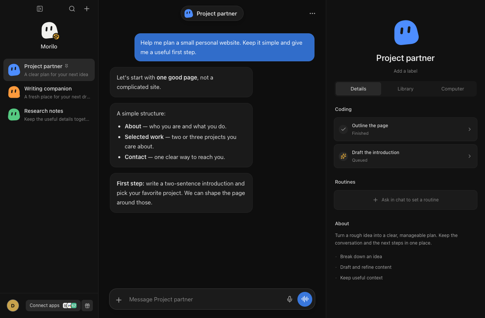

# Morilo

**桌面上的个人 AI 工作空间。**

[English](README.md) | 简体中文

Morilo 是一个基于 Go、MyGo 和 React 的早期桌面 AI 应用。它将多个助手和会话放在同一工作空间，支持流式回复、本地资料，以及可选的应用连接和远程电脑。Agent 会话由 Pi RPC CLI 驱动。



*截图来自原生 macOS 界面，使用展示用示例会话，并非真实模型调用记录。*

## 功能

- **多助手、多会话**：按工作内容组织对话，不必把所有事情放进同一个线程。
- **流式、易读的回复**：支持 Markdown、连续短消息气泡，以及简洁的进度提示，不直接铺开工具日志。
- **本地资料与历史**：会话、偏好和导入记忆保存在本机，不同资料之间分开存储。
- **个性化设置**：明暗主题、强调色、中英文界面和时区上下文。
- **可选应用连接**：通过 Composio 连接 GitHub、Vercel，仅开放已实现的只读工具白名单。
- **可选远程电脑**：连接 Instabox 机器、观看桌面，并按需启用交互控制。

> **项目状态：** 当前已验证的桌面平台是 macOS。纯浏览器预览使用模拟回复；真实 Agent 执行需要桌面应用和已配置的模型服务。演示账单、邀请、权限及保险库设置已移除；定时任务尚未实现。

## 安装

安装包面向 **macOS 13.5 或更新版本**，支持 Apple Silicon 和 Intel，包含 **Node.js 24.22.2 与 Pi 1.5.0**。使用安装包不需要安装 Go、Node 或 Pi。

从 [GitHub Releases](https://github.com/hifizz/morilo/releases/latest) 下载安装包：Apple Silicon（M 系列）选择 `arm64`，Intel 选择 `amd64`。打开 DMG，将 Morilo 拖到「应用程序」。

文件名标有 `unsigned` 的包使用临时签名，未经 Developer ID 签名和 Apple 公证。如果 macOS 拦截了从本仓库下载的应用，请先尝试打开，再前往 **系统设置 → 隐私与安全性 → 仍要打开**。

[GitHub Actions](https://github.com/hifizz/morilo/actions/workflows/build.yml) 也会为 `main` 和 `develop` 生成预览包。版本 tag 会发布到 GitHub Releases，无需先配置 Apple 发布凭据。详见[分发说明](docs/distribution.md)。

## 本地运行

### 环境要求

- macOS：当前已验证的原生开发流程。
- Go **1.27.3 或更新版本**。
- Node.js 版本见 [`.node-version`](.node-version)（**24.22.2**）和 npm。
- 可用的模型服务：用于真实聊天。

无需全局安装 Pi：`npm run prepare:runtime` 会准备内置 Node + 固定版本 Pi 运行时；仅在未准备时才回退到已安装的 `pi`。

```bash
git clone https://github.com/hifizz/morilo.git
cd morilo
npm ci
npm --prefix frontend ci
npm run prepare:runtime
npm run dev
```

在 macOS 上，`npm run dev` 会准备专用的本地开发签名身份，启动端口为 3000 的 Vite，并打开 **Morilo Dev.app**。该本地开发流程不要求订阅 Apple Developer。详见[开发与签名说明](docs/development.md)。

### 配置模型服务

首次启动的引导流程会要求配置模型服务：选择预设（OpenAI、Anthropic、Google Gemini、Ollama 或 OpenAI 兼容服务），按需调整协议与 Base URL，粘贴 API Key，并手动输入模型 ID 或「获取模型列表」。「测试并保存」会向你的服务发送一次简短的真实请求，可能按你的套餐计费。本地服务可勾选「不需要 API Key」。高级设置包含图片输入、推理、上下文窗口与最大输出 tokens，需与服务商实际能力一致。

密钥只保存在系统凭据服务中。Morilo 在 `<userData>/pi-agent/managed` 写入不含密钥的托管 Pi 配置，**不会使用或修改全局 Pi 配置**；`connections.json` 只存凭据的不透明引用，不落密钥。

| 构建类型 | Pi 配置目录 |
| --- | --- |
| 开发版 | `~/Library/Application Support/Morilo Dev/pi-agent/` |
| 打包版 | `~/Library/Application Support/Morilo/pi-agent/` |

已有且有效的应用专属 `pi-agent` 配置会保留并视为已完成配置；不会迁移或删除任何数据。

### 可选服务

- **GitHub / Vercel**：在桌面应用中打开「连接应用」，配置 Composio 项目 API Key。该密钥保存在系统凭据服务中。仍需留意连接账户的授权范围：Morilo 的工具白名单不会缩小底层 Token 自身的权限。
- **Instabox**：在 **设置 → 电脑**（或首次引导）中用你的个人 Instabox API Key 连接，然后选择一台机器。「创建远程电脑」需要输入名称、展示服务返回的规格，并经明确确认后才会创建；费用由你的 Instabox 账户按套餐收取。创建中的机器有持久化记录，可恢复跟踪或停止跟踪——停止跟踪不会删除机器也不会停止计费。同一表单支持更换密钥（创建进行中不可更换）。环境变量 `INSTABOX_API_KEY`/`INSTABOX_MACHINE_ID`/`INSTABOX_API_URL` 仍作为旧配置的兼容回退，但不是新装默认方式。

  工作模式：**仅聊天**（新装默认，无文件和应用工具）、**本机**（Agent 工具在 `~/morilo-workspace` 中以你的完整系统权限运行——不是沙箱，需明确确认）、**远程电脑**（你的 Instabox 机器）。

## 开发命令

| 命令 | 用途 |
| --- | --- |
| `npm run dev` | 启动原生应用和前端开发服务器 |
| `npm run build` | 构建前端并打包桌面应用 |
| `npm run generate` | 重新生成 Go 到 TypeScript 的类型化绑定 |
| `npm --prefix frontend run dev` | 仅启动浏览器预览，使用模拟回复 |
| `CGO_ENABLED=0 go test ./...` | 离线业务测试，默认跳过付费模型调用 |
| `MORILO_LIVE_TEST=1 go test . -run '^TestPiSessionRoundTrip$' -v` | 显式启用旧 Pi 配置的真实往返测试；需要有效凭据，可能产生模型服务费用 |
| `npm --prefix frontend run test:markdown` | 检查 Markdown 渲染与不安全内容处理 |

在已验证的 Apple Silicon 环境中，macOS 打包产物位于 `build/darwin-arm64/`。本地构建不会自动完成面向公开分发的公证。

## 项目结构

- `main.go`：桌面宿主、窗口和服务绑定。
- `agent.go`：按会话管理的 Pi RPC 进程与聊天事件流。
- `settings.go` / `store.go`：本地资料、偏好和会话持久化。
- `integrations.go` / `integrations/`：Composio 集成与只读工具桥。
- `computer.go` / `computer/`：远程电脑服务与 Instabox 适配器。
- `frontend/`：React、TypeScript、Vite 和 Tailwind 界面。
- `docs/development.md`：本地签名及系统凭据服务说明。

## 数据与凭据

本地存储不等于离线运行：提示词和导入记忆可能会发送到配置的模型服务，可选集成也会与对应服务通信。Pi 可以在你的机器上执行工具，本地执行不等于沙箱隔离。

请勿提交 API Key、本机应用数据或生成的构建产物。应用使用独立的 Pi 配置目录，不主动复用全局 Pi 凭据。

## 开源协议

[MIT](LICENSE) — Copyright (c) 2026 hifizz。第三方依赖保留各自的许可证。
